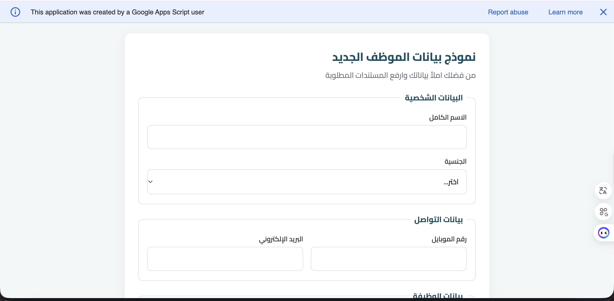
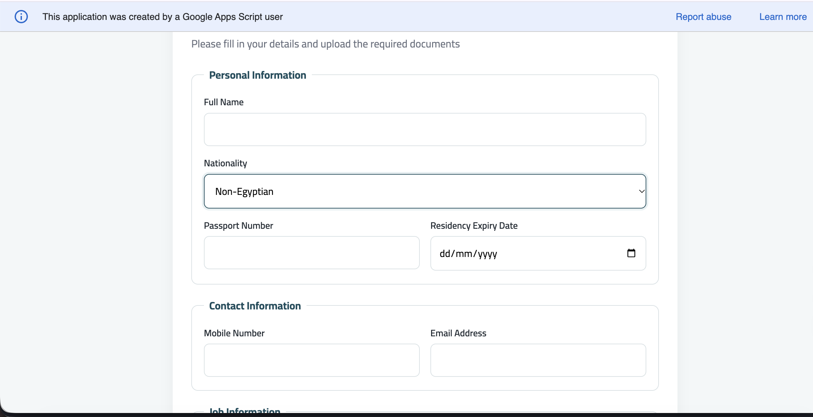
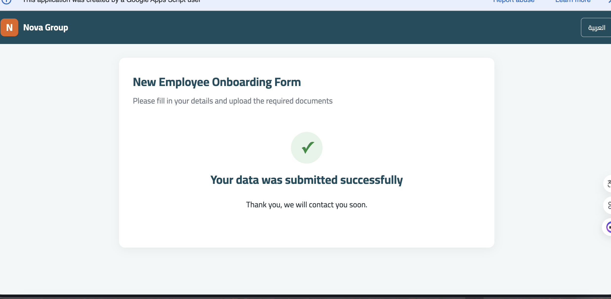
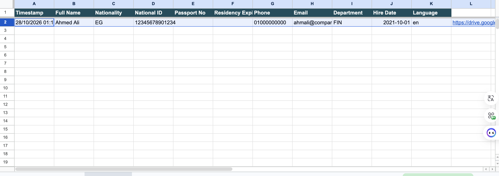
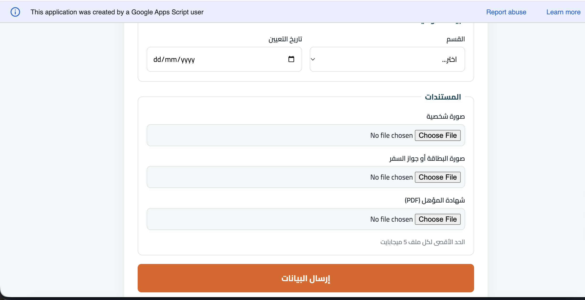

# Employee Onboarding Form — Google Apps Script

A bilingual (Arabic / English) employee onboarding form built with **Google Apps Script**.
New hires fill in their details and upload their documents; everything is saved automatically to **Google Sheets** and **Google Drive**, and email notifications are sent to HR and to the employee.

> نموذج تسجيل بيانات موظفين جدد بلغتين (عربي / إنجليزي): البيانات تتحفظ في Google Sheets، والمستندات تترفع على Google Drive في فولدر لكل موظف، ويتبعت إيميل تلقائي للمسؤول وللموظف.

**🔗 Live demo:** [Open the form](https://script.google.com/macros/s/AKfycbzvJ928qft2OmuBDxyyjutWc4ZsdW2VAudkYtcA9rJEPSKqviNRh9I1CSL8DG2SdIxc/exec)



---

## ✨ Features

- **Bilingual UI** — switch between Arabic (RTL) and English (LTR) with one click; validation messages switch too.
- **Smart conditional fields** — Egyptian applicants enter a 14-digit National ID; non-Egyptians enter passport number and residency expiry date.
- **Two-layer validation** — instant feedback in the browser, plus server-side checks that can't be bypassed.
- **Document uploads** — photo, ID/passport and qualification certificate, with file type and size (5 MB) checks.
- **Organized Drive storage** — one folder per employee (`YYYY-MM-DD - Full Name`) with consistently named files.
- **Google Sheets database** — one row per submission, with a direct link to the employee's documents folder.
- **Automatic emails** — an HR notification with a summary table and a folder link, and a confirmation email to the employee in their chosen language.
- **Mobile-friendly** — responsive layout that works on phones and desktops.
- **Safe concurrent submissions** — `LockService` prevents rows from mixing when two people submit at the same time.

## 📸 Screenshots

| Arabic | English |
|---|---|
|  |  |

| Conditional fields | Validation |
|---|---|
|

| Success message | Mobile view |
|---|---|
|  |  |

| Google Sheet | HR email notification |
|---|---|
|  |  |

## 🏗️ How It Works

```
 Browser (Index.html + Script.html)            Server (Code.js)
 ┌───────────────────────────────┐            ┌──────────────────────────────┐
 │ 1. Validate fields & files     │            │ 4. Validate again             │
 │ 2. Read files as Base64        │  google.   │ 5. Create employee folder     │
 │ 3. Send data  ─────────────────── script ──▶│    and save files to Drive    │
 │                                │   .run     │ 6. Append row to the Sheet    │
 │ 8. Show success message ◀─────────────────────7. Send emails (HR + employee)│
 └───────────────────────────────┘            └──────────────────────────────┘
```

## 🛠️ Tech Stack

- **Google Apps Script** (V8 runtime)
- **HTML / CSS / JavaScript** (no frameworks)
- **Google Sheets**, **Google Drive**, **Gmail** (`MailApp`)
- **clasp** for local development and version control with Git

## 📁 Project Structure

```
employee-onboarding-form/
├── src/
│   ├── appsscript.json   # Project settings (time zone, web app access)
│   ├── Code.js           # Server: doGet, validation, Drive, Sheets, emails
│   ├── Index.html        # Form markup
│   ├── Styles.html       # CSS
│   └── Script.html       # Client logic: translations, validation, submit
├── docs/                 # Screenshots for this README
├── .clasp.json
└── README.md
```

## 🚀 Setup

### 1. Prerequisites
- A Google account
- [Node.js](https://nodejs.org/) (LTS)
- clasp: `npm install -g @google/clasp`
- Enable the Apps Script API: <https://script.google.com/home/usersettings>

### 2. Create the project
```bash
git clone https://github.com/AmanyFekry/employee-onboarding-form.git
cd employee-onboarding-form
rm .clasp.json
clasp login
clasp create --type sheets --title "Employee Onboarding" --rootDir src
clasp push
```

### 3. Configure the admin email
In the Apps Script editor go to **Project Settings → Script Properties** and add:

| Property | Value |
|---|---|
| `ADMIN_EMAIL` | the email address that should receive new submissions |

### 4. Authorize permissions
In the editor, select **`setupSheet`** and click **Run**. Approve the requested permissions (Sheets, Drive and sending email).
This also creates the `Employees` sheet with its headers.

> ⚠️ Whenever a new Google service is added to the code, run any function from the editor again to approve the new permission. Otherwise that service will fail silently in the web app.

### 5. Deploy
**Deploy → New deployment → Web app**
- Execute as: **Me**
- Who has access: **Anyone**

Copy the Web app URL; that's your form link.

## 🎨 Customization

| What | Where |
|---|---|
| Company name, labels, messages (AR/EN) | `translations` object in `Script.html` |
| Colors | CSS variables at the top of `Styles.html` |
| Departments | `<select id="department">` in `Index.html` + `DEPARTMENTS` in `Code.js` |
| Required documents, allowed types, max size | `FILE_RULES` and `MAX_FILE_BYTES` in `Code.js` (and `fileRules` in `Script.html`) |
| Email templates | `buildAdminEmail` / `buildEmployeeEmail` in `Code.js` |

## 🔒 Security Notes

- Uploaded documents are stored in the deploying account's Drive and are **private by default**; applicants cannot see other submissions.
- All input is validated on the server, and user text is HTML-escaped before it's placed in emails.
- The admin email is stored in Script Properties, not in the source code.
- Phone numbers and national IDs are stored as text so leading zeros are preserved.

## 👩‍💻 Author

**Amany Fekry** — Software Engineer (MSc in Software Engineering, Cairo University)
Web development · Business systems · Google Workspace automation

- GitHub: [@AmanyFekry](https://github.com/AmanyFekry)

Need a custom form or automation for your business? Feel free to get in touch.